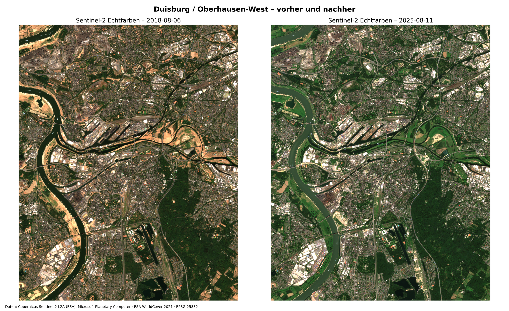
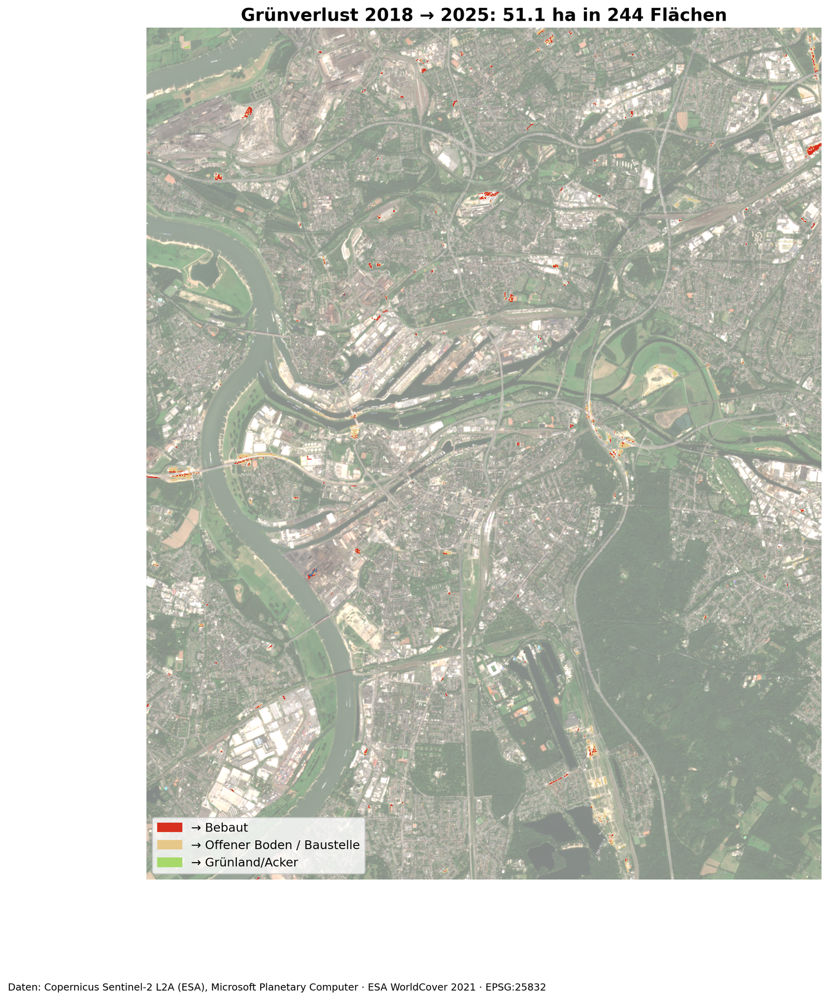
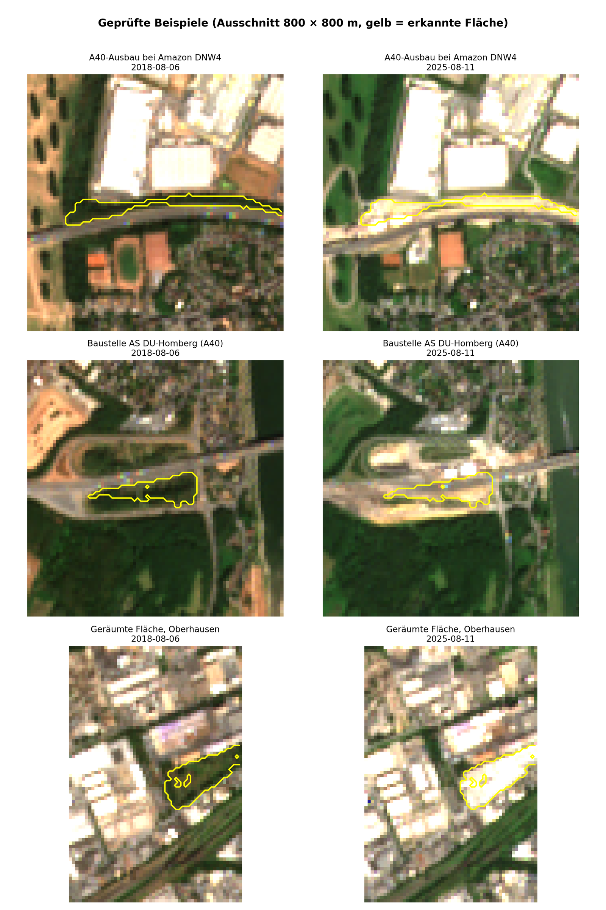
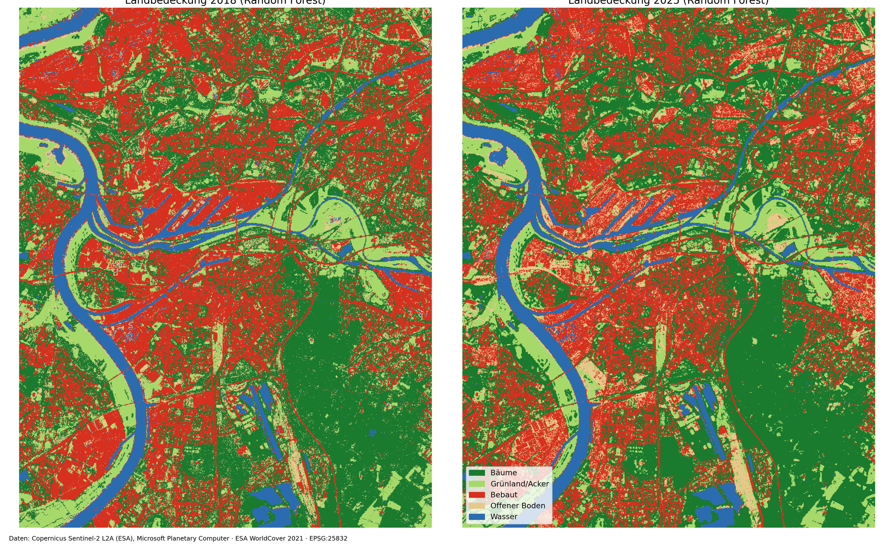

# Sentinel-2 Change Detection – Duisburg / Oberhausen-West

[English](#sentinel-2-change-detection--duisburg--oberhausen-west) | [Deutsch](#deutsch)

Detection of **green space loss between summer 2018 and summer 2025** in Duisburg / Oberhausen-West (NRW, Germany) using **Sentinel-2 satellite imagery**, **Python** and a **Random Forest** land cover classification – fully reproducible in a single Jupyter notebook.



---

## Key results

| | |
|---|---|
| Study area | 10.8 × 13.7 km (148 km²), Sentinel-2 tile 32ULC, 10 m pixels |
| Scenes | 6 Aug 2018 (0.18 % clouds) and 11 Aug 2025 (0.01 % clouds) |
| **Green space lost 2018 → 2025** | **51.1 ha in 244 patches** (≥ 500 m² each) |
| → bare soil / construction sites in 2025 | **28.7 ha (56 %)** |
| → built-up (buildings, roads) in 2025 | **21.0 ha (41 %)** |
| Water excluded from the analysis | 895 ha (Rhine, harbour basins, lakes) |
| Random Forest accuracy (independent test pixels) | 74.8 % (2018), 77.2 % (2025) |

More than half of the lost green space was still **bare soil or a construction site** in August 2025. The largest patches are linked to the **A40 motorway widening and the new Rhine bridge Duisburg-Neuenkamp**, plus cleared plots in industrial and logistics areas.



### Verification

The three largest patches were checked against current aerial imagery (Google Maps) – **all three are real changes**:

| # | Area | Land cover 2025 | What it is |
|---|---|---|---|
| 1 | 2.27 ha | bare soil* | cleared plot in an industrial area, Oberhausen |
| 2 | 2.16 ha | bare soil | A40 widening next to the Amazon DNW4 logistics centre |
| 3 | 1.76 ha | bare soil | construction site at the A40 junction DU-Homberg (new Rhine bridge) |

\* classified as *built-up* by the Random Forest – bright dry soil is spectrally similar to concrete and roofs.



---

## Method

1. **Data access** – Sentinel-2 L2A via the STAC API of Microsoft Planetary Computer (`pystac-client`, `odc-stac`); bands B02, B03, B04, B08 (10 m) and B11 (20 m → 10 m); reprojected to ETRS89 / UTM 32N (EPSG:25832); correction of the +1000 offset introduced with processing baseline 04.00
2. **Scene selection** – least cloudy summer scene per year from the same tile (32ULC) to avoid seasonal and geometric differences
3. **NDVI** – (NIR − Red) / (NIR + Red) for both dates
4. **Rule-based change detection**
   - dense vegetation in 2018 (**NDVI ≥ 0.5**) and sealed or bare in 2025 (**NDVI < 0.25**)
   - water masked with **NDWI > 0** in either year
   - connected-component filter: patches **< 5 pixels (500 m²)** removed
5. **Land cover classification** – Random Forest (200 trees, scikit-learn), 5 classes (trees, grassland/cropland, built-up, bare soil, water), 8 features (5 bands + NDVI, NDWI, NDBI); training labels sampled from **ESA WorldCover 2021** (up to 3,000 pixels per class, 70/30 train/test split); **one model per year**
6. **Change characterisation** – land cover 2025 on every loss patch (pixel share and dominant class per patch)
7. **Export** – maps (PNG), rasters (GeoTIFF), patches as polygons (GeoPackage, GeoJSON) and table (CSV), all in EPSG:25832 (GeoJSON in WGS 84)

### Why not simply compare the two land cover maps?

Summer **2018 was an extreme drought**: grassland along the Rhine was brown, and the mean NDVI of the area was 0.42 compared with 0.51 in 2025.

- A plain **NDVI difference** therefore shows mostly *greening* and is not a valid change indicator.
- **Comparing the class areas** of the two Random Forest maps gives implausible results (e.g. "built-up −316 ha"). With roughly 25 % error per map, the errors of two independent classifications add up and exceed the real change.

The final workflow therefore detects **where** change happened with a drought-robust rule (only vegetation that was green *even in the drought* counts) and uses the classifier only to describe **what** the area became.



---

## Limitations

- **Two single dates.** Changes that happened and disappeared in between (e.g. a temporary construction site) are not captured; a dense time series would be more robust.
- **10 m resolution.** Changes smaller than about 500 m² (single houses, small gardens) are not detected.
- **Loss only.** New green space (e.g. renaturation, planted areas) was not assessed.
- **Training labels from 2021.** WorldCover itself has about 75–80 % accuracy and is from a different year than both images; this limits the classifier to about 75 % accuracy.
- **Bare soil vs. built-up** are often confused (see patch #1).
- **Thresholds are project-specific** (NDVI 0.5 / 0.25, NDWI 0, 500 m²).
- Only three patches were verified visually; no formal accuracy assessment of the change map.

---

## Repository structure

```
├── notebooks/   Jupyter notebook with the complete workflow
├── images/      result maps
└── results/     GeoTIFF rasters, loss patches (GPKG, GeoJSON) and table (CSV)
```

## Run it

Open `notebooks/sentinel2_change_detection_duisburg.ipynb` in **Google Colab** (*File → Upload notebook*) and select *Runtime → Run all*, or run it locally with the packages in `requirements.txt`. No account or API key is needed. Change `bbox` to analyse any other area.

**Tools:** Python · pystac-client · odc-stac · xarray · rioxarray · scikit-learn · SciPy · GeoPandas · Matplotlib · Google Colab

**Data sources:** Copernicus Sentinel-2 L2A (ESA), via Microsoft Planetary Computer · ESA WorldCover 2021 (CC BY 4.0)

---

<a name="deutsch"></a>

# Sentinel-2-Veränderungsanalyse – Duisburg / Oberhausen-West

[English](#sentinel-2-change-detection--duisburg--oberhausen-west) | [Deutsch](#deutsch)

Erkennung von **Grünflächenverlust zwischen Sommer 2018 und Sommer 2025** in Duisburg / Oberhausen-West (NRW) mit **Sentinel-2-Satellitenbildern**, **Python** und einer **Random-Forest**-Klassifikation der Landbedeckung – vollständig reproduzierbar in einem Jupyter-Notebook.

## Zentrale Ergebnisse

| | |
|---|---|
| Untersuchungsgebiet | 10,8 × 13,7 km (148 km²), Sentinel-2-Kachel 32ULC, 10-m-Pixel |
| Szenen | 06.08.2018 (0,18 % Wolken) und 11.08.2025 (0,01 % Wolken) |
| **Grünverlust 2018 → 2025** | **51,1 ha in 244 Flächen** (je ≥ 500 m²) |
| → 2025 offener Boden / Baustelle | **28,7 ha (56 %)** |
| → 2025 bebaut (Gebäude, Straßen) | **21,0 ha (41 %)** |
| Ausgeschlossene Wasserfläche | 895 ha (Rhein, Hafenbecken, Seen) |
| Genauigkeit Random Forest (unabhängige Testpixel) | 74,8 % (2018), 77,2 % (2025) |

Mehr als die Hälfte der verlorenen Grünflächen war im August 2025 noch **offener Boden bzw. Baustelle**. Die größten Flächen hängen mit dem **Ausbau der A40 und der neuen Rheinbrücke Duisburg-Neuenkamp** zusammen sowie mit geräumten Flächen in Industrie- und Logistikgebieten.

### Überprüfung

Die drei größten Flächen wurden mit aktuellen Luftbildern (Google Maps) abgeglichen – **alle drei sind reale Veränderungen**:

| Nr. | Fläche | Landbedeckung 2025 | Was ist dort? |
|---|---|---|---|
| 1 | 2,27 ha | offener Boden* | geräumte Fläche im Gewerbegebiet, Oberhausen |
| 2 | 2,16 ha | offener Boden | Ausbau der A40 neben dem Amazon-Logistikzentrum DNW4 |
| 3 | 1,76 ha | offener Boden | Baustelle Anschlussstelle DU-Homberg (A40, neue Rheinbrücke) |

\* vom Random Forest als *bebaut* klassifiziert – heller, trockener Boden ist spektral Beton und Dächern ähnlich.

## Methodik

1. **Datenzugang** – Sentinel-2 L2A über die STAC-API von Microsoft Planetary Computer (`pystac-client`, `odc-stac`); Kanäle B02, B03, B04, B08 (10 m) und B11 (20 m → 10 m); Umprojektion nach ETRS89 / UTM 32N (EPSG:25832); Korrektur des Offsets +1000 ab Processing Baseline 04.00
2. **Szenenauswahl** – wolkenärmste Sommerszene je Jahr aus derselben Kachel (32ULC)
3. **NDVI** – (NIR − Rot) / (NIR + Rot) für beide Zeitpunkte
4. **Regelbasierte Veränderungserkennung** – 2018 dichte Vegetation (**NDVI ≥ 0,5**) und 2025 versiegelt/offen (**NDVI < 0,25**); Wassermaske mit **NDWI > 0**; Flächen **< 5 Pixel (500 m²)** entfernt
5. **Klassifikation der Landbedeckung** – Random Forest (200 Bäume, scikit-learn), 5 Klassen, 8 Merkmale (5 Kanäle + NDVI, NDWI, NDBI); Trainingsdaten aus **ESA WorldCover 2021** (bis 3.000 Pixel je Klasse, 70/30 Training/Test); **ein Modell je Jahr**
6. **Charakterisierung** – Landbedeckung 2025 auf jeder Verlustfläche
7. **Export** – Karten (PNG), Raster (GeoTIFF), Flächen als Polygone (GeoPackage, GeoJSON) und Tabelle (CSV)

### Warum nicht einfach die beiden Landbedeckungskarten vergleichen?

Der Sommer **2018 war extrem trocken**: Das Grünland am Rhein war braun, der mittlere NDVI lag bei 0,42 gegenüber 0,51 im Jahr 2025.

- Eine reine **NDVI-Differenz** zeigt deshalb überwiegend *Ergrünen* und ist als Veränderungsindikator ungeeignet.
- Der **Flächenvergleich** zweier unabhängiger Klassifikationen liefert unplausible Werte (z. B. „bebaut −316 ha“), da sich die Fehler beider Karten (je ca. 25 %) addieren.

Der Workflow erkennt daher **wo** sich etwas verändert hat mit einer dürre-robusten Regel (nur Vegetation, die *selbst in der Dürre* grün war, zählt) und nutzt den Klassifikator nur, um zu beschreiben, **was** aus der Fläche geworden ist.

## Einschränkungen

- **Nur zwei Zeitpunkte** – zwischenzeitliche Veränderungen werden nicht erfasst; eine dichte Zeitreihe wäre robuster.
- **10 m Auflösung** – Veränderungen unter ca. 500 m² (einzelne Häuser, kleine Gärten) werden nicht erkannt.
- **Nur Verlust** – neue Grünflächen (z. B. Renaturierung) wurden nicht bewertet.
- **Trainingsdaten von 2021** – WorldCover hat selbst ca. 75–80 % Genauigkeit und stammt aus einem anderen Jahr.
- **Offener Boden und bebaut** werden häufig verwechselt (siehe Fläche Nr. 1).
- **Schwellenwerte sind projektbezogen** (NDVI 0,5 / 0,25, NDWI 0, 500 m²).
- Nur drei Flächen wurden visuell geprüft; keine formale Genauigkeitsbewertung der Veränderungskarte.

## Ausführen

`notebooks/sentinel2_change_detection_duisburg.ipynb` in **Google Colab** öffnen (*Datei → Notebook hochladen*) und *Laufzeit → Alle ausführen* wählen, oder lokal mit den Paketen aus `requirements.txt`. Kein Konto und kein API-Schlüssel nötig. Über `bbox` lässt sich jedes andere Gebiet analysieren.

**Werkzeuge:** Python · pystac-client · odc-stac · xarray · rioxarray · scikit-learn · SciPy · GeoPandas · Matplotlib · Google Colab

**Datenquellen:** Copernicus Sentinel-2 L2A (ESA), über Microsoft Planetary Computer · ESA WorldCover 2021 (CC BY 4.0)

---

*Konstantinos Chantzis · 2026 · MIT License*
